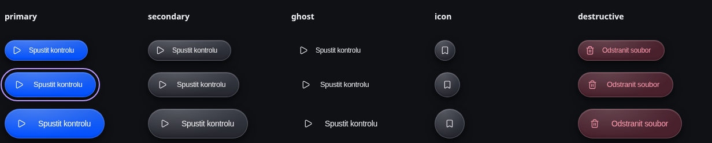
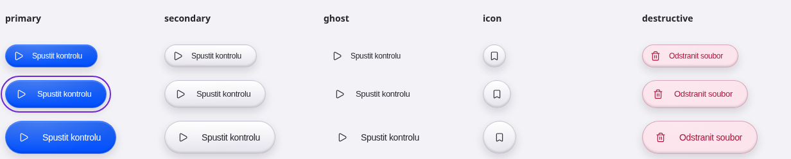
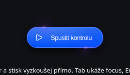

# Button · Lens 02 Clean Icon — implementace k revizi

Izolovaná větev `experiment/ds-button-lens-02`, základ `02a2ff32b8da590d0d7232c063a43d62bc736e7d`. Žádná migrace produkčních tlačítek, změna Header Rebuildu ani deployment.

## Kde komponentu vyzkoušet

```sh
npm ci
npm run dev -- --port 4192
```

Otevřít `http://localhost:4192/axolotl-2/app.html?catalog=buttons#design-system`.
Katalog používá skutečný export `src/design-system/Button`, ne demonstrační kopii. Téma a velikost textu přebírá z existujícího nastavení aplikace. Playground nabízí varianty, velikosti, disabled/loading, Star Border, barvu, dobu oběhu a omezení pohybu. Hover, stisk a focus se zkoušejí skutečnou interakcí, nikoli falešnými CSS třídami. Původní ButtonGallery zůstává ve sbalené sekci legacy; existující `components/ui/Button` zatím zůstává pro své konzumenty.

Samostatná ověřovací stránka bez providerů: `/axolotl-2/scripts/button-lens-02/fixture.html` (pouze dev; není vstupem produkčního buildu).

## API

```tsx
import { Button } from './design-system/Button';
import { Play, Bookmark } from 'lucide-react';

<Button variant="primary" size="medium" icon={<Play strokeWidth={1.7} />}
  loading={saving} loadingLabel="Probíhá kontrola" onClick={run}>
  Spustit kontrolu
</Button>

<Button variant="secondary" motion="star-border"
  starBorder={{ color: '#7C3AED', duration: 4 }}>
  Spustit akci
</Button>

<Button variant="icon" size="small" icon={<Bookmark strokeWidth={1.7} />}
  aria-label="Uložit do oblíbených" onClick={save} />
```

| Prop | Hodnoty / výchozí stav |
| --- | --- |
| `variant` | `primary`, `secondary` (výchozí), `ghost`, `icon`, `destructive` |
| `size` | `small` / `medium` (výchozí) / `large` — 36 / 44 / 52 px; small na coarse pointer 44 px |
| `motion` | `none` (výchozí) / `star-border` |
| `starBorder` | `{ color?: string; duration?: number }`; barva CSS, výchozí `#7C3AED`, doba oběhu 4 s; minimum 0,3 s |
| `icon` | Dekorativní ReactElement, vizuálně 16 px. Pro `variant="icon"` povinný; TS vyžaduje `aria-label` nebo `aria-labelledby`. |
| `loading` | `false`; `aria-busy`, blokace aktivace, zachování focusu a názvu akce |
| `loadingLabel` | Volitelný vizuální stavový text; rezervuje prostor předem, nemění přístupný název |
| `disabled` | Nativní disabled, vynechá tab pořadí |
| `theme` | `dark` / `light`; jinak dědí nejbližší `data-theme`, bez provideru výchozí dark |
| `reducedMotion` | Pouze omezuje; nemůže obejít OS ani nadřazené `data-motion="reduced"` |
| nativní props + `ref` | `type`, `name`, `value`, `form`, `aria-*`, eventy a HTMLButtonElement ref; výchozí `type="button"` |

Button neřídí asynchronní operaci ani živá oznámení. Konzument nastavuje `loading` a případný `role="status"` pro výsledek. `loading` používá `aria-disabled` a blokuje click/capture i nativní submit, aby zůstal focus. Explicitní `disabled` používá nativní atribut. Neměnit `type` na submit bez záměru odeslat formulář. Odkazy / `asChild` nejsou v této iteraci součástí API.

## Zachovaný vzhled

Vizuální zdroj: [Lens 02 · Clean Icon](https://iriskax.github.io/axolotl-preview/lens-02-clean-icon/), commit [`0428979`](https://github.com/irisKaX/axolotl-2/commit/0428979396961c7c0c4c6ecd2fc726164c2c457f).

- Kapsle 100 px, původní radiální odlesk + lineární gradient, vnitřní a vnější stíny.
- Modrá Primary `#2464ed → #0050ff`, neutrální Secondary/Icon/Ghost, původní destruktivní paleta. Fialový focus a volitelné světelné stopy; žádné nové přebarvení Primary.
- Ikona bez samostatného podkladu, borderu a stínu. Icon-only má jeden společný povrch.
- Původní rozměry, sazba, spacing, zdvih při hover a stisk scale(.975).
- Dark/light paleta vytažená do lokálních `--axo-button-*` tokenů; existující globální tokeny neměníme.

## Technické úpravy oproti experimentu

- Stabilní nativní `<button>` a ref ve všech stavech; aktivace motion již nevyměňuje kořenový DOM prvek.
- Rozdělené API variant / size / motion, přístupný název ikonového tlačítka, nativní formulářové chování.
- Loading zachovává focus a název akce, blokuje opakované spuštění. Spinner je dekorativní; bez ikony se zobrazí uprostřed, původní text zůstává v accessibility tree. S `loadingLabel` a ikonou zůstává šířka stabilní i při delším stavovém textu.
- `min-height` a zalamování místo pevné výšky/nowrap; aplikace může zvětšit text přes svůj `--axolotl-text-scale`. Tlačítka bez ikony mají symetrický padding.
- Živé změny OS/app reduced motion, forced colors a viditelnosti stránky. Star Border v klidu vůbec nemá canvas ani běžící engine. Při disabled/loading zůstává statický okraj, bez světelných stop a hover/stisku. Spinner při reduced motion zůstává statický.
- Bez nových npm závislostí a bez provázání komponenty na aplikační providery.

## Originální React Bits Star Border

Vendored soubory jsou beze změny z [DavidHDev/react-bits](https://github.com/DavidHDev/react-bits/tree/c2a1408d9219a5bd7a2d9c93c9c499042f5fa34a/src/content/Animations/StarBorder), commit `c2a1408d9219a5bd7a2d9c93c9c499042f5fa34a`; stejné jako v Lens experimentu. Jde o skutečný canvas engine s obíhajícími stopami, ne napodobeninu gradientem. Adaptér předává původnímu `as` vlastní host-ref na již existující button; engine dodává canvas a posluchače, komponenta řídí povrch a sémantiku. Výchozí radius 100, dvě stopy, hover brighten, bez clickPulse/sparkle.

Licence **MIT + Commons Clause** je zachována v `src/design-system/Button/vendor/LICENSE.md`. Commons Clause není čistá MIT licence; případná distribuce placené samostatné komponentové knihovny vyžaduje zvláštní posouzení.

SHA-256 originálů:

```
StarBorder.jsx 8a82730322a9db4e1f0ceddf312a0b4bdf8a27d10b84ed4f49e93d1977d004c6
StarBorder.css 128fe0068b2d7964c28488d24465626ff34f3143a66082a6548a1a1f57c987d2
LICENSE.md     4bdd1fa59a6b7d5954bc3b213dbc34e455c635a94bbcecf9293553797d0fad02
```

## Výsledky ověření · 19. 10. 2026

| Kontrola | Výsledek |
| --- | --- |
| TypeScript + produkční build | PASS; bez nových závislostí |
| Vitest | **67/67**, 15 souborů; z toho 10 testů nového Button |
| Připnutá vizuální reference | **30/30** variant/velikostí v dark/light: shodné vypočtené barvy, gradienty, stíny, sazba a rozměry; navíc reálný hover/pressed/focus Primary Medium v obou tématech. Geometrie porovnaná na 0,001 px. |
| Axe · nový showcase | **0 porušení** v dark i light; nejde o náhradu ruční čtečky obrazovky |
| Chromium · klávesnice/formuláře | Enter/Space, submit, disabled, loading, stabilní DOM/focus/šířka PASS |
| Originální Star Border | Canvas mění snímky; nastavitelná barva/duration; vypnutí při loading/disabled/OS i app reduced motion/forced colors PASS |
| Touch emulace | **390 a 320 px**, obě témata, 44px small target, aktivace, text 200 % bez horizontálního přetečení PASS |
| Skutečná aplikace | Katalog + AppHeader; změna tématu, 115% textu a omezení animací přes existující providery a Radix Nastavení PASS; 390px layout PASS |
| Runtime chyby prohlížeče | **0** |

[Strojový protokol](evidence/verification.json) · [API a zdroj komponenty](../../src/design-system/Button/Button.tsx)

### Screenshoty

[Desktop v aplikaci](evidence/application-catalog.png) · [Light / text 115 %](evidence/application-light-115.png) · [Mobil v aplikaci](evidence/application-mobile.png) · [Mobil dark](evidence/dark-mobile.png) · [Mobil light](evidence/light-mobile.png)

Dark / focus a všech 15 základních kombinací:



Light / focus:



Skutečný Star Border — zachycený okamžik obíhajících stop:



## Opakování ověření

```sh
npm test
npm run build
# Pro porovnání je potřeba lokálně dostupný připnutý commit experimentu:
git fetch origin experiment/lens-02-clean-icon-20261019
# V druhém terminálu běží dev server na portu 4192:
PLAYWRIGHT_CHROME_EXECUTABLE=/usr/bin/chromium node scripts/button-lens-02/check.mjs
```

Prohlížečový skript sestaví referenci přímo z připnutého commitu do dočasné `.button-check/`. Porovnává vypočtené styly a rozměry, skutečné interakce, kreslení canvasu, omezení pohybu, dotykové viewporty a katalog v aplikaci. `evidence/verification.json` a screenshoty obsahují výsledek posledního běhu. `.button-check` není součástí komponenty ani buildu.

Fyzický Mac/iPhone, Safari VoiceOver a NVDA zde nejsou dostupné. Mobilní Chromium emulace není náhradou finální kontroly na iOS. Schválený vzhled zůstává referencí; tato implementace čeká na schválení před integrací.
